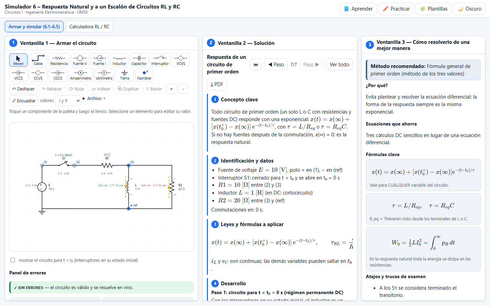
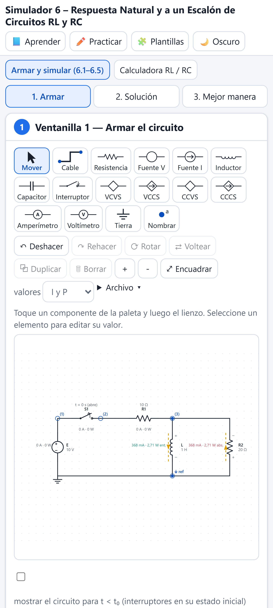

# Simulador 6 – Respuesta Natural y a un Escalón de Circuitos RL y RC

Simulador web de la **Unidad 6 de Circuitos I** (sigla 197900021, Ingeniería Electromecánica, UMSS – Cochabamba; docente Ing. Abg. Juan Antonio Rodríguez Sejas). Se arma cualquier circuito RL o RC con interruptores que abren o cierran en el instante que uno elija, y se ve la respuesta en el tiempo: la solución analítica por intervalos comparada con la integración numérica.

**Página publicada:** https://angelja19.github.io/simulador-6-respuesta-rl-rc/

| Escritorio | Celular |
| --- | --- |
|  |  |

## Funciones

- **Respuesta natural y al escalón:** usa x(t) = x(∞) + [x(t₀⁺) − x(∞)]·e^(−(t−t₀)/τ) para cualquier variable, con τ = L/R_eq o τ = R_eq·C.
- **Método completo (Ventanilla 2):** circuito para t < t₀ en DC → condición inicial → continuidad → R_eq vista por L o C (Thévenin) y τ → valor final → ecuación.
- **Interruptores:** se ponen en cualquier lugar, con su instante y su acción (abrir o cerrar). Con varios interruptores (llaveo secuencial) la respuesta se encadena por intervalos.
- **Fuentes dependientes:** R_eq se obtiene con una fuente de prueba.
- **Gráficas:** v e i de cualquier elemento, marcas de τ (63,2 %) y 5τ, y la curva analítica superpuesta a la numérica (trapezoidal con paso adaptativo y arranque con Euler implícito). Al pasar el mouse por la gráfica, el dibujo muestra los valores en ese instante.
- **Energía:** compara la energía inicial almacenada con la disipada en las resistencias; en la respuesta natural deben coincidir.
- **Validador:** avisa si un inductor quedaría con su corriente interrumpida o si un capacitor sería forzado a cambiar de voltaje al instante (impulso). También avisa cuando el circuito no es de primer orden.
- **Calculadora RL / RC:** para estudiar τ, la respuesta natural y la respuesta al escalón sin armar el circuito.

## Casos verificados por las pruebas

- RC carga: τ = 1 ms. RC descarga: v_C(0) = 12·5/7 V y τ = 50 ms. RL natural: I₀ = 1 A y W₀ = 0,5 J, igual a la energía disipada. RL escalón: i_L → 3 A. Llaveo secuencial: τ pasa de 1 ms a 0,5 ms. RC con dependiente: R_eq = 8 kΩ.
- En todos los casos la solución numérica coincide con la analítica con un error menor a 0,1 %.

## Uso

```bash
npm install
npm run dev
npm test
npm run test:e2e
```

Licencia [MIT](LICENSE).
